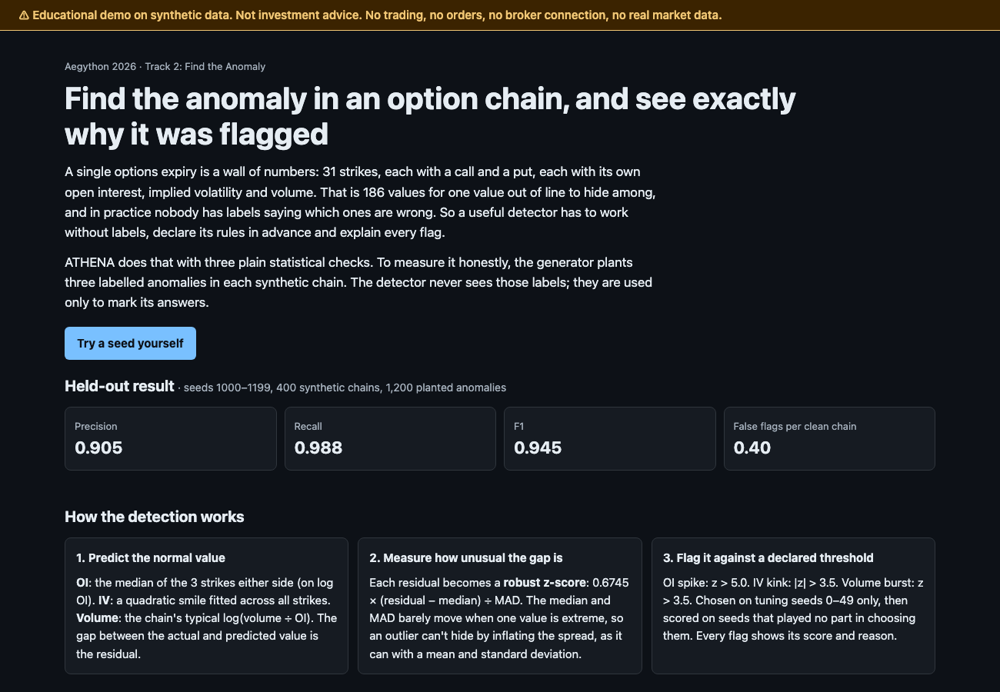
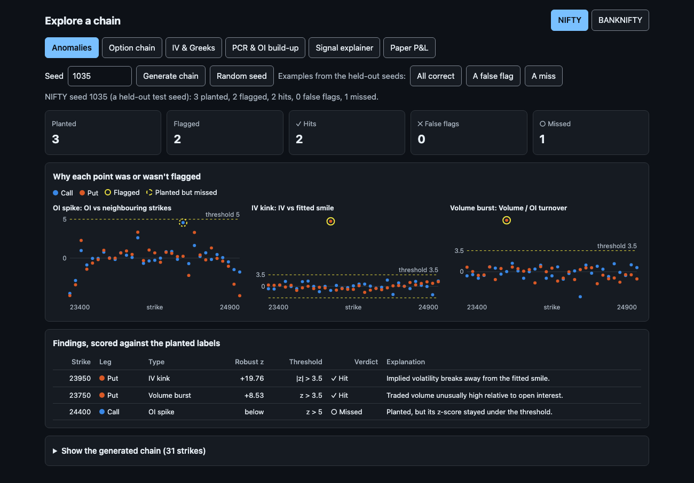
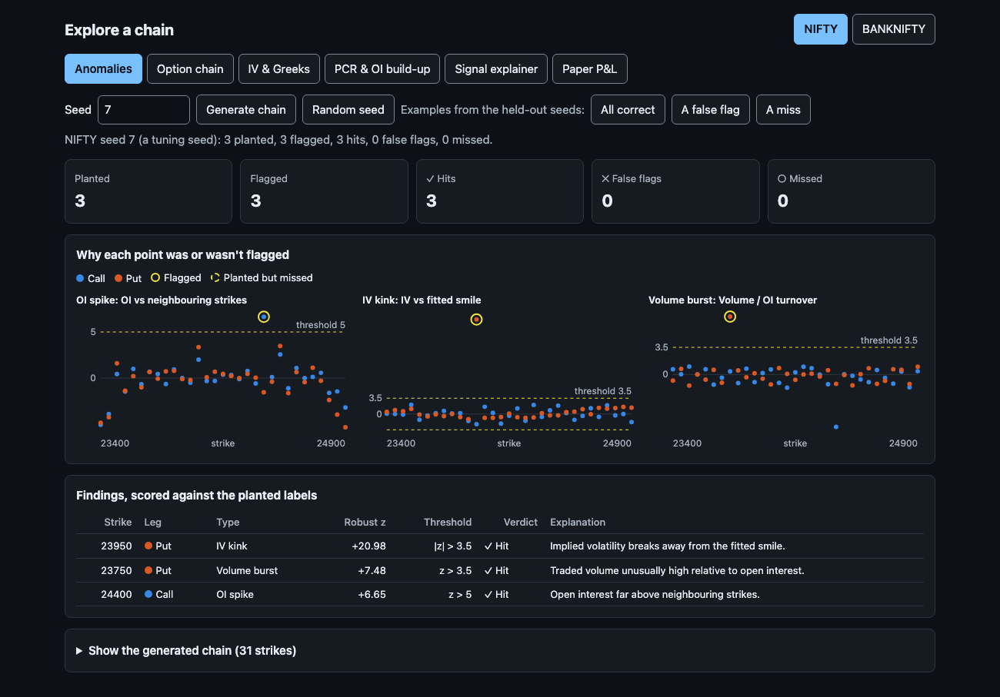
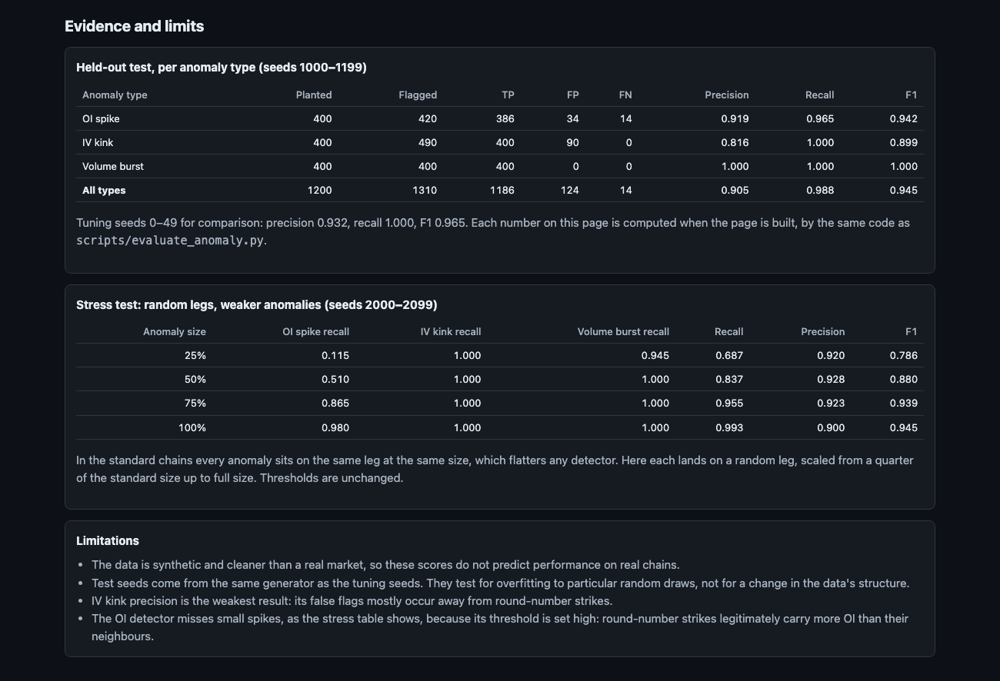
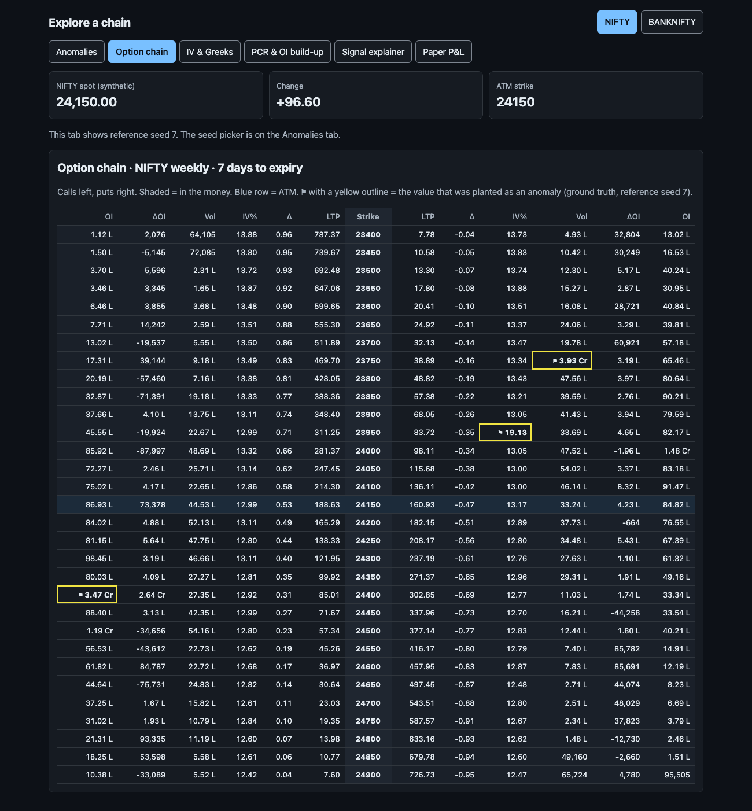
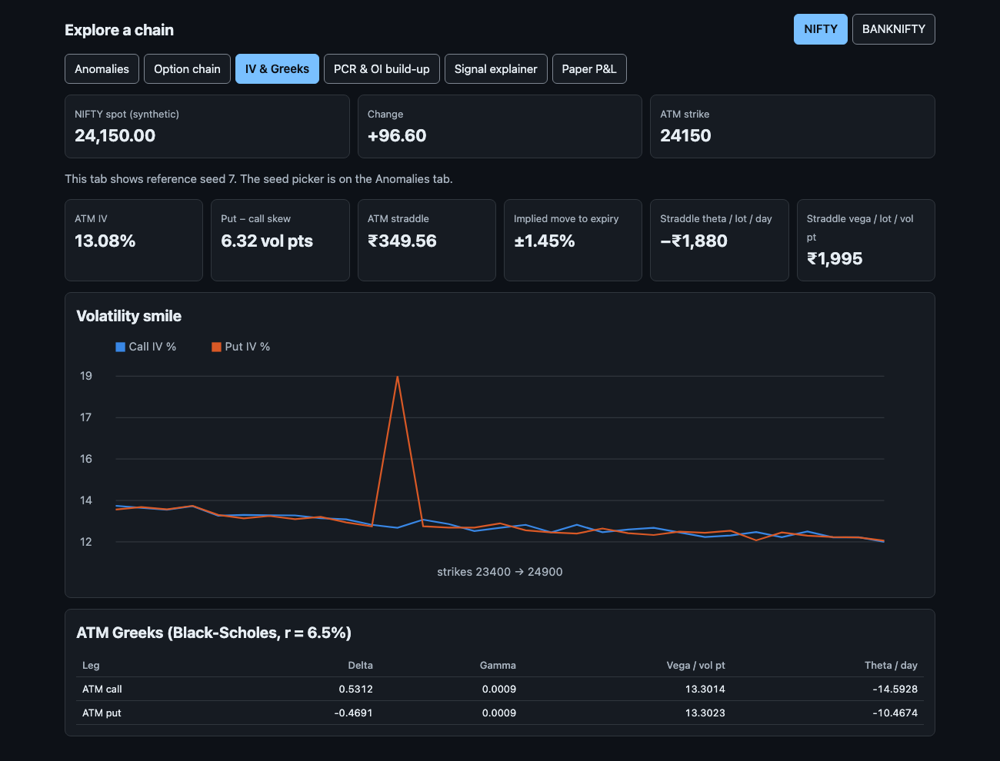
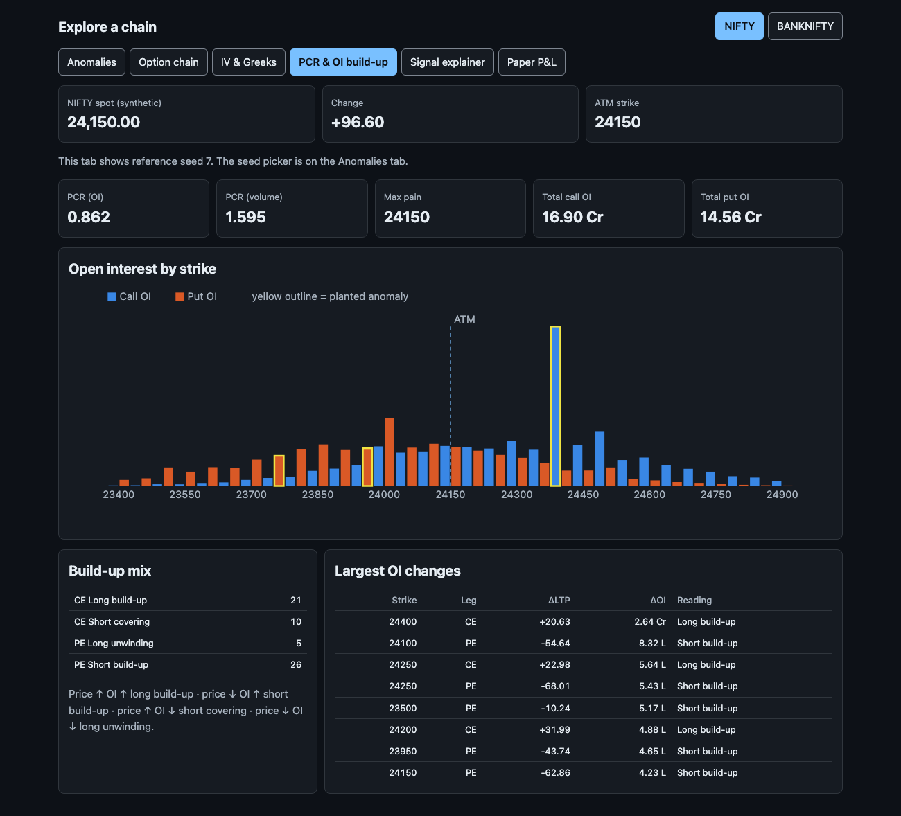
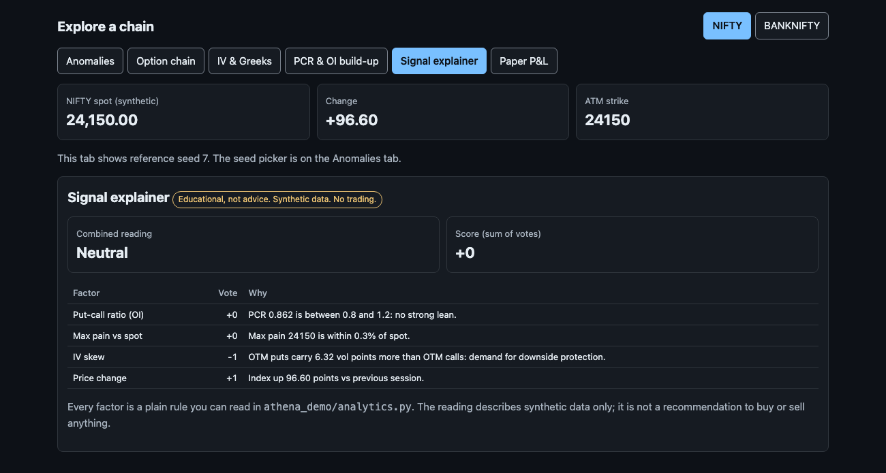
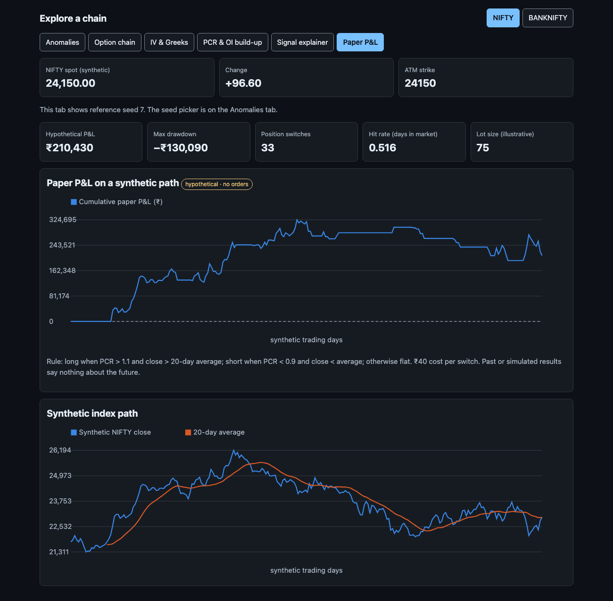
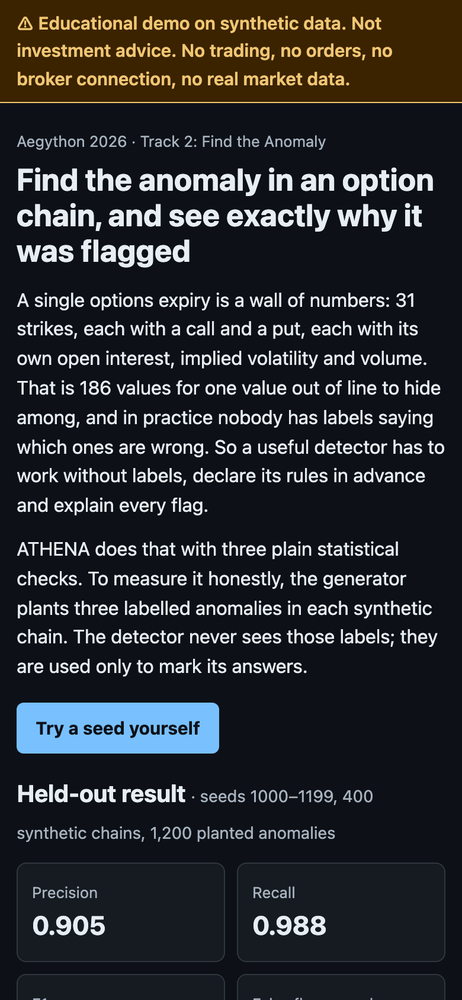

# ATHENA Analytics Demo

Educational options analytics for **NIFTY** and **BANKNIFTY** on **synthetic data**, with an
explainable anomaly detector. Built for Aegython 2026, Track 2: Find the Anomaly. One command builds a
self-contained static web page and proves the result is reproducible.

> ## ⚠ Not investment advice · No trading
> This project is an educational demo. It **does not trade**, contains **no order code**,
> **no broker SDKs or endpoints**, **no API keys** and **no real market data**. Every price,
> open-interest figure and price path is generated from a fixed random seed by
> `athena_demo/synthetic.py`. The "signal" and "paper P&L" views describe made-up data and are
> not recommendations to buy or sell anything. Simulated results say nothing about the future.

## What it shows

| Tab | What you get |
|---|---|
| Anomalies | Pick any seed and regenerate a chain in the browser. See every strike's z-score against its threshold, with each flag scored as hit, false flag or miss |
| Option chain | 31-strike weekly chain: OI, ΔOI, volume, IV, delta, LTP for calls and puts; ATM and ITM shading |
| IV & Greeks | Volatility smile chart, ATM IV, put−call skew, straddle price, implied move, ATM Greeks, straddle theta/vega per lot |
| PCR & OI build-up | OI and volume PCR, max pain, OI-by-strike chart, long/short build-up and covering/unwinding classification |
| Signal explainer | Four transparent rules (PCR, max pain, skew, price change) that each vote −1/0/+1, with the reason shown. Labelled *educational, not advice* |
| Paper P&L | Hypothetical rule-based P&L curve, drawdown and hit rate on a synthetic 250-day index path |

The seed picker drives the Anomalies tab. The other tabs show the reference seed, 7.

## Run it

Reference version: **Python 3.12** (checked on 3.12.14). Nothing else is needed: standard library only,
no install step. Python 3.9.6 and 3.11.16 were also checked and produce byte-identical output. `run_all.sh`
refuses anything older than 3.9.

```sh
./run_all.sh
```

That one command builds the page, evaluates the detector, runs the tests and then rebuilds into a temporary
folder to prove the output is byte-identical. It stops at the first failure and ends with `ALL STEPS PASSED`.
To choose an interpreter: `PYTHON=/path/to/python3.12 ./run_all.sh`.

The individual steps:

```sh
python3 -m athena_demo.build                                                  # writes docs/index.html + docs/data/*.json
python3 -m unittest -v                                                        # all tests
python3 scripts/evaluate_anomaly.py --out docs/data/anomaly_evaluation.json   # the numbers below
```

Open `docs/index.html` in a browser. Deep links work: `docs/index.html#idx=BANKNIFTY&tab=anomaly&seed=1011`.
The `docs/` folder is ready for GitHub Pages ("Deploy from branch", folder `/docs`).

Two checks need optional tools and do not affect the Python pipeline:

- **Node** runs `tests/test_js_parity.py`, which proves the browser generates the same chains and findings as
  Python. Without Node those 3 tests report as skipped.
- **Node and Chrome** run `node scripts/browser_check.js`, which loads the page at phone and desktop widths and
  fails on sideways scrolling, a script error or any network request. Add `--screenshots` to refresh `screenshots/`.

## Screenshots

| | |
|---|---|
|  |  |
|  |  |
|  |  |
|  |  |
|  |  |

## The intelligent part: explainable anomaly detection

**The problem.** One expiry has 186 values to check (31 strikes × call and put × OI, IV and volume). Real chains
carry no labels saying which values are wrong, so a detector has to work unsupervised, commit to its rules in
advance and explain each flag.

### Method

`athena_demo/anomaly.py` runs three detectors on each option leg. Each predicts a normal value, takes the residual
and converts it to a **robust z-score**, `0.6745 × (residual − median) ÷ MAD`. The median and MAD barely move when one
value is extreme, so an outlier cannot hide by inflating the spread, as it can with a mean and standard deviation.

### Thresholds, declared up front

| Detector | Residual | Flag when | Why this direction |
|---|---|---|---|
| OI spike | log OI minus the median log OI of the 3 strikes either side | z > 5.0 | A build-up is the event of interest. The higher bar is because round-number strikes legitimately carry more OI |
| IV kink | IV minus a least-squares quadratic smile in log-moneyness | \|z\| > 3.5 | A break from the smile matters in either direction |
| Volume burst | log(volume ÷ OI) against the chain's median | z > 3.5 | Unusually heavy trading is the event of interest |

These constants were chosen on tuning seeds 0–49 only, and a test fails if they change. The generator plants one labelled
anomaly of each type per chain. Labels are used only for scoring; another test deletes them and confirms the findings
do not change.

### Held-out evaluation

Run on seeds 1000–1199 across both indices: 400 chains, 1,200 planted anomalies. Full output is in
`docs/data/anomaly_evaluation.json`. A test fails if these tables, that file or a fresh run disagree.

| Anomaly type | Planted | Flagged | TP | FP | FN | Precision | Recall | F1 |
|---|---:|---:|---:|---:|---:|---:|---:|---:|
| OI spike | 400 | 420 | 386 | 34 | 14 | 0.919 | 0.965 | 0.942 |
| IV kink | 400 | 490 | 400 | 90 | 0 | 0.816 | 1.000 | 0.899 |
| Volume burst | 400 | 400 | 400 | 0 | 0 | 1.000 | 1.000 | 1.000 |
| **All types** | 1200 | 1310 | 1186 | 124 | 14 | 0.905 | 0.988 | 0.945 |

Tuning seeds 0–49, for comparison (100 chains):

| Anomaly type | Planted | Flagged | TP | FP | FN | Precision | Recall | F1 |
|---|---:|---:|---:|---:|---:|---:|---:|---:|
| OI spike | 100 | 103 | 100 | 3 | 0 | 0.971 | 1.000 | 0.985 |
| IV kink | 100 | 119 | 100 | 19 | 0 | 0.840 | 1.000 | 0.913 |
| Volume burst | 100 | 100 | 100 | 0 | 0 | 1.000 | 1.000 | 1.000 |
| **All types** | 300 | 322 | 300 | 22 | 0 | 0.932 | 1.000 | 0.965 |

False flags on clean chains with nothing planted: 0.25 per chain on the tuning seeds and 0.40 on the test seeds.

**Where the errors are.** IV kink produces most false flags: 90 of 124. Only 7 of those 90 are at round-number strikes,
so round numbers don't explain them. A likely cause is that a MAD estimated from 31 points is itself noisy, but that has
not been tested. All 34 OI false flags are at round-number strikes, and all 14 misses are OI spikes.

### Stress test

The standard chains plant each anomaly on the same leg at the same size, which flatters any detector. The stress test
uses seeds 2000–2099 (200 chains per row), puts each anomaly on a random leg and scales its size, with the thresholds unchanged.
Size 100% means the standard sizes: OI × 4.5, IV × 1.45, volume = 6 × OI.

| Anomaly size | OI spike recall | IV kink recall | Volume burst recall | Precision | Recall | F1 |
|---:|---:|---:|---:|---:|---:|---:|
| 25% | 0.115 | 1.000 | 0.945 | 0.920 | 0.687 | 0.786 |
| 50% | 0.510 | 1.000 | 1.000 | 0.928 | 0.837 | 0.880 |
| 75% | 0.865 | 1.000 | 1.000 | 0.923 | 0.955 | 0.939 |
| 100% | 0.980 | 1.000 | 1.000 | 0.900 | 0.993 | 0.945 |

The OI detector is the weak point. It finds 11.5% of quarter-size spikes (OI × 1.875) and 51.0% of half-size ones (OI × 2.75).

### Limitations

- **Synthetic only.** The data is cleaner than a real market, so these scores do not predict performance on real chains. Nothing here has been run on real data.
- **Same generator.** The test seeds differ from the tuning seeds, but share the same generator. They test for overfitting to particular random draws, not for a change in the data's structure.
- **Volume burst's perfect score is partly the generator's doing.** Normal turnover is drawn from a narrow bounded range (0.3–0.7 × OI), so a real chain's heavier tails would produce false flags here that this data cannot.
- **The test seeds have now been inspected, per type.** Tuning again against them would invalidate them, so any threshold change needs a new held-out range. Git history starts after the thresholds were set, so it cannot itself prove the order of tuning and testing.
- **One chain at a time.** The detector has no memory of previous days. Each chain is scored on its own.
- **The three types are the ones it looks for.** It is not a general detector, and other kinds of anomaly would go unseen.
- **A flag means unusual, not meaningful.** A z-score ranks strangeness; it is not a probability and says nothing about cause.

### In the browser

`athena_demo/engine.js` re-implements the generator and detector, including Python's exact random number algorithm, so any
seed produces the same chain in the page as in Python. `tests/test_js_parity.py` compares the two across 18 chains, value by value.

The page declares a Content-Security-Policy of `default-src 'none'`, so the browser itself blocks network requests from it.

## Layout

```
athena_demo/bs.py         Black-Scholes price, Greeks, implied-vol solver
athena_demo/synthetic.py  seeded chain + price-path generator with planted anomalies
athena_demo/analytics.py  PCR, max pain, OI build-up, IV/Greeks summary, signal explainer
athena_demo/anomaly.py    robust z-score anomaly detectors
athena_demo/evaluation.py per-type precision, recall and F1 across seed ranges, plus the stress test
athena_demo/backtest.py   hypothetical paper P&L on a synthetic path
athena_demo/site.py       static HTML/SVG renderer (no CDN, no JS libraries)
athena_demo/engine.js     the generator and detector for the browser, matching Python value for value
athena_demo/ui.js         page behaviour: tabs, seed picker, z-score charts
scripts/                  evaluate_anomaly.py (the numbers), browser_check.js (real-browser checks, screenshots)
tests/                    unit tests, including guards that fail if order/network/key code appears
run_all.sh                build, evaluate, test and prove reproducibility
```

## Data, attribution and licensing

- Data: 100% synthetic, generated in this repository. No third-party data or models.
- Formulas: textbook Black-Scholes; standard PCR, max-pain and OI build-up definitions.
- Code: original, MIT licensed (see `LICENSE`).

## Other limitations

- Black-Scholes assumes constant volatility and European exercise.
- Lot sizes and costs are illustrative, not current exchange values.
- The signal rules are deliberately simple and are not a strategy.
- The paper P&L ignores slippage, margin and gaps.
